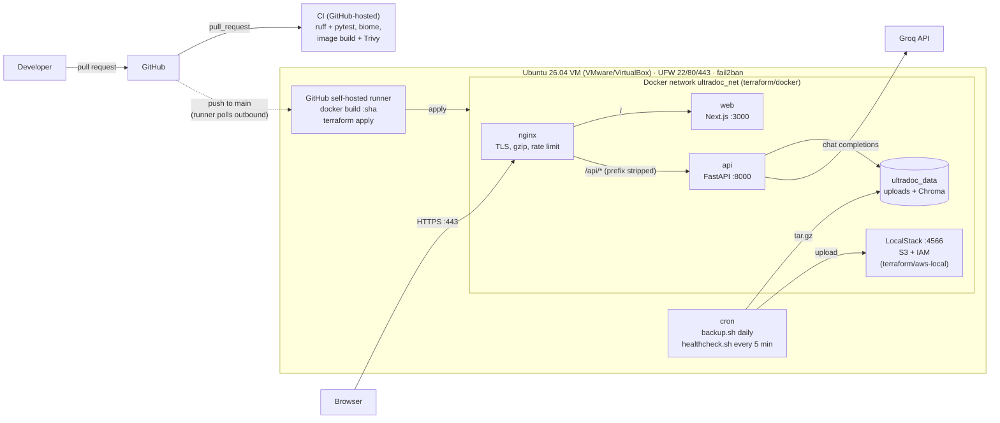

# Ship-Doc-AI DevOps

[](https://github.com/sunny-pixels/ship-doc-ai-devops/actions/workflows/ci.yml)
[](https://github.com/sunny-pixels/ship-doc-ai-devops/actions/workflows/deploy.yml)


-FF9900?logo=amazonaws&logoColor=white)


A production-style DevOps platform for a real web application: an AI
document-intelligence app (Next.js frontend, FastAPI backend, vector
database, LLM API). The app is deployed to a hardened Linux server with
infrastructure as code, a security-gated CI/CD pipeline with automatic
rollback, TLS reverse proxy, automated backups to S3 and scheduled health
reporting. Everything runs for free on a local VM, with AWS emulated by
LocalStack.

> The application itself (RAG pipeline, API, evals) is documented in
> [docs/APPLICATION.md](docs/APPLICATION.md). This README covers the
> infrastructure, automation and operations work.

## Highlights

| Area | What was built | Verified result |
|---|---|---|
| **CI/CD** | GitHub Actions: lint, tests, Docker builds and Trivy scan on every PR; push-to-deploy on a self-hosted runner | CI green in ~7 min; Deploy #2 shipped commit `259d110` to the server end to end |
| **Automatic rollback** | Deploy health-checks `/api/health` + `/api/ready` and re-applies the previous image tag on failure | Deliberately broken release failed its health check and was rolled back to healthy |
| **Security scanning** | Trivy gate fails the pipeline on fixable CRITICAL CVEs | Caught **9 CRITICAL CVEs** (3 RCE in Next.js, 5 in Pillow, 1 in certifi); all fixed, gate now passes |
| **Infrastructure as code** | Terraform: Docker provider (network, volume, 4 containers) + AWS provider (S3, IAM) | `terraform plan` shows no drift; rebuilt all 8 resources after the Docker host was wiped |
| **Server hardening** | One idempotent script: deploy user, key-only SSH, UFW, fail2ban, unattended upgrades | Password SSH refused (`Permission denied (publickey)`); re-run finishes in 24 s with no changes |
| **Container hardening** | Non-root users, `HEALTHCHECK`, `.dockerignore`, models baked in at build time | Removed an LLM API key that the original Dockerfile copied into the image |
| **Reverse proxy** | Nginx: TLS, HTTP→HTTPS, gzip, 10 req/s rate limit, 10 MB body limit | 40-request burst → 29 × `200`, 11 × `429`; oversized upload → `413` |
| **Backup & DR** | Consistent volume snapshots to versioned, encrypted S3 with checksums and retention | Backup → change data → restore returned the exact earlier state; API paused < 1 s |
| **Monitoring** | Cron health report every 5 min: disk, memory, container health, HTTP endpoints | Detects stopped containers and exits non-zero for alerting |
| **Documentation** | Runbook for incidents, rollback, certificate renewal, log analysis | [docs/RUNBOOK.md](docs/RUNBOOK.md) |

## Tech stack

| Layer | Tools |
|---|---|
| Server | Ubuntu Server 26.04 LTS on VMware Workstation (24.04 also supported), systemd, cron, logrotate |
| Security | OpenSSH (key-only), UFW, fail2ban, unattended-upgrades, Trivy, least-privilege IAM, GitHub Secrets |
| Containers | Docker Engine, multi-stage Dockerfiles, Docker Compose (local dev) |
| Infrastructure as code | Terraform 1.x: `kreuzwerker/docker`, `hashicorp/aws` |
| Cloud (emulated) | LocalStack: S3 (versioning, lifecycle, SSE), IAM |
| CI/CD | GitHub Actions, self-hosted runner, SHA-pinned actions, actionlint |
| Web / proxy | Nginx (TLS, rate limiting, gzip), Next.js, FastAPI |
| Scripting | Bash (shellcheck-clean), Python |

## Architecture



| Piece | Where | What it does |
|---|---|---|
| Hardened images | `apps/*/Dockerfile`, `.dockerignore` | Non-root users, `HEALTHCHECK`, models baked to `/app/models`, no `.env` in images |
| Readiness probe | `GET /ready` | 200 only if the data dir is writable and Chroma opens (`/health` is liveness) |
| Reverse proxy | `nginx/default.conf` | `/` → web, `/api/*` → api (prefix stripped), HTTP→HTTPS, gzip, 10 r/s rate limit, 10 MB body limit |
| App infrastructure | `terraform/docker/` | kreuzwerker/docker: network, data volume, api/web/nginx/LocalStack containers |
| AWS-style resources | `terraform/aws-local/` | hashicorp/aws → LocalStack: versioned, encrypted backup bucket with lifecycle rules; least-privilege IAM user |
| Server setup | `scripts/server-setup.sh` | Deploy user, key-only SSH, UFW, fail2ban, Docker, Terraform, AWS CLI, swap, unattended upgrades |
| Operations | `scripts/{backup,restore,healthcheck}.sh` | Volume backups to S3, restores, health reports (see [docs/RUNBOOK.md](docs/RUNBOOK.md)) |
| CI/CD | `.github/workflows/{ci,deploy}.yml` | PR checks; deploy to the VM with automatic rollback |

## CI/CD flow

- **Pull request → `ci.yml`** (GitHub-hosted runners):
  1. API: `ruff check` + `pytest` (`/health`, `/ready`).
  2. Web: `biome check`.
  3. Build both images and scan them with Trivy; any fixable CRITICAL CVE fails the PR.
- **Push to `main` → `deploy.yml`** (self-hosted runner on the VM):
  1. Build `ultradoc-api:<git-sha>` and `ultradoc-web:<git-sha>` on the VM (no registry needed).
  2. `terraform apply -var image_tag=<git-sha>` replaces only containers whose image changed.
  3. Health check through nginx (`/api/health` + `/api/ready`, 10 tries × 6 s).
  4. Success: record the tag in `/opt/ultradoc/state/current_tag`, install `scripts/` for cron, prune old images (keeps current + previous).
  5. Failure: `terraform apply` with the previous tag, re-check, and fail the job.
- Secrets live only in GitHub Actions secrets (`LLM_API_KEY`) and reach Terraform as `TF_VAR_llm_api_key`.
- Actions are pinned to commit SHAs.
- The self-hosted runner only runs `deploy.yml` on pushes to `main`, never on PRs, so code from forks never executes on the VM.
- Known limitation: there is one container per service, replaced in place. A failed release
  means about 2–3 minutes of API downtime until the rollback finishes (tested by deploying an
  image whose healthcheck never passes). Blue/green behind nginx would remove that.

## Run the stack locally (Docker Compose)

```bash
scripts/gen-certs.sh
docker compose up --build            # https://localhost (accept the self-signed cert)
# Ports 80/443 busy? HTTP_PORT=8080 HTTPS_PORT=8443 docker compose up --build
```

## Bring it up on a fresh VM

**On your PC:**
1. Create a VM (VMware Workstation or VirtualBox; tested on VMware Workstation 17 + Ubuntu 26.04.1):
   - Ubuntu Server 24.04 or 26.04 LTS ISO, 2–4 vCPU, 6 GB RAM, 40 GB disk (store it on a drive with space).
   - Network: NAT (VMware: the PC reaches the VM IP directly) or Bridged. VirtualBox NAT needs port forwards 2222→22, 443→443.
   - In the installer: untick "LVM group" (else only half the disk is used), tick **Install OpenSSH server**, pick no snaps (not docker).
2. Copy your SSH key to the VM (PowerShell):
   ```powershell
   ssh-keygen -t ed25519            # once, if you have no key yet
   type $env:USERPROFILE\.ssh\id_ed25519.pub | ssh <user>@<vm-ip> "mkdir -p ~/.ssh && cat >> ~/.ssh/authorized_keys"
   ```

**On the VM**, as the user you created during install:

```bash
sudo apt-get update && sudo apt-get install -y git
git clone https://github.com/<you>/ultradoc-ai.git && cd ultradoc-ai
sudo scripts/server-setup.sh          # creates "deploy", hardens SSH (key-only from now on)
```

Then, as `deploy` (`ssh deploy@<vm-ip>`):

```bash
git clone https://github.com/<you>/ultradoc-ai.git ~/ultradoc-ai && cd ~/ultradoc-ai

# 1. TLS cert covering the VM's IP
CERT_DIR=/opt/ultradoc/certs scripts/gen-certs.sh <vm-ip>

# 2. First build (later builds come from the deploy workflow)
docker build -t ultradoc-api:manual apps/api
docker build -t ultradoc-web:manual --build-arg NEXT_PUBLIC_API_BASE_URL=/api/ apps/web

# 3. App + LocalStack containers
cd terraform/docker
terraform init -backend-config="path=/opt/ultradoc/state/docker.tfstate"
read -rs TF_VAR_llm_api_key && export TF_VAR_llm_api_key      # paste the Groq key
terraform apply -var image_tag=manual -var cert_dir=/opt/ultradoc/certs
echo manual > /opt/ultradoc/state/current_tag

# 4. Backup bucket + IAM user in LocalStack
cd ../aws-local
terraform init -backend-config="path=/opt/ultradoc/state/aws-local.tfstate"
terraform apply

# 5. Config for the ops scripts (holds the backup user's keys)
install -m 600 ~/ultradoc-ai/scripts/ultradoc.env.example /opt/ultradoc/ultradoc.env
sed -i "s|^AWS_ACCESS_KEY_ID=.*|AWS_ACCESS_KEY_ID=$(terraform output -raw backup_access_key_id)|; \
        s|^AWS_SECRET_ACCESS_KEY=.*|AWS_SECRET_ACCESS_KEY=$(terraform output -raw backup_secret_access_key)|" \
  /opt/ultradoc/ultradoc.env

# 6. Ops scripts + cron
cp -a ~/ultradoc-ai/scripts /opt/ultradoc/app/
crontab ~/ultradoc-ai/scripts/crontab.example
/opt/ultradoc/app/scripts/healthcheck.sh && /opt/ultradoc/app/scripts/backup.sh
```

Open `https://<vm-ip>` from your PC and accept the self-signed certificate.

Cron entries (`scripts/crontab.example`):

```cron
2   2 * * *  /opt/ultradoc/app/scripts/backup.sh >> /opt/ultradoc/logs/backup.log 2>&1
*/5 * * * *  /opt/ultradoc/app/scripts/healthcheck.sh > /dev/null 2>&1
```

## GitHub setup (secrets + self-hosted runner)

1. **Secret:** repo → Settings → Secrets and variables → Actions → *New repository secret*:
   `LLM_API_KEY` = your Groq key. Optional *variable* `LLM_MODEL` (default `openai/gpt-oss-120b`).
2. **Runner:** repo → Settings → Actions → Runners → *New self-hosted runner* → Linux x64.
   Run the download commands it shows on the VM as `deploy` (in `~/actions-runner`), then:
   ```bash
   ./config.sh --url https://github.com/<you>/ultradoc-ai --token <token-from-page> \
     --name ultradoc-vm --labels ultradoc --unattended
   sudo ./svc.sh install deploy && sudo ./svc.sh start
   ```
   The runner connects outbound to GitHub, so the VM needs no inbound port for it.
3. Push to `main`, then watch the **Deploy** run under the Actions tab.

Day-2 operations (app down, disk full, backup/restore, rollback, certificate
renewal, logs) are in [docs/RUNBOOK.md](docs/RUNBOOK.md).

## Security

- **Server:** SSH keys only, root login disabled, `MaxAuthTries 3`; UFW allows
  only 22 (rate-limited), 80 and 443; fail2ban bans brute-force IPs; security
  patches install automatically.
- **Containers:** API runs as uid 10001, web as `node`; only nginx publishes
  ports; LocalStack binds to `127.0.0.1`; container logs are size-capped.
- **Secrets:** the LLM key lives only in GitHub Actions secrets, the API
  container's environment and the Terraform state (`/opt/ultradoc/state`,
  mode `700`, files `600`). It is never in git or in an image.
- **Supply chain:** every third-party action is pinned to a commit SHA
  (trivy-action tags were hijacked in March 2026); the runner binary is
  verified against GitHub's SHA-256; Trivy blocks fixable CRITICAL CVEs.
- **Least privilege:** the backup IAM user can list one bucket and get/put its
  objects. It cannot delete; old backups expire through the lifecycle rule.
- **Self-hosted runner:** only runs `deploy.yml` on pushes to `main`, never on
  pull requests, so fork code never executes on the server.

## Real incidents found and fixed

| Incident | Root cause | Fix |
|---|---|---|
| Uploads stalled for 141 s | Node resolved `localhost` to IPv6 `::1`; the API only listened on IPv4, so the health probe failed and the UI retried for 2 min | Use `127.0.0.1` / service names; probe timing confirmed in Chrome DevTools (141 s → 1 s) |
| LLM API key inside the Docker image | Dockerfile `COPY . .` with no `.dockerignore` | Added `.dockerignore` for both apps; key now only reaches the container at runtime |
| Pipeline blocked by 9 CRITICAL CVEs | Outdated `next`, `pillow`, `certifi` | Upgraded; verified OCR and retrieval scores unchanged (0.744 before and after) |
| Host disk at 0 bytes, Docker read-only | Docker Desktop's 27 GB virtual disk on a full C: drive | Freed space, moved Docker's data root to another drive, documented in the runbook |
| API reported "unhealthy" after every backup | Docker marks a paused container unhealthy until the next probe | Backup waits for healthy after unpause; healthcheck re-checks once before alerting |
| Package install frozen on Ubuntu 26.04 | `apt-get` stopped (state `T`) when run as `sudo … \| tee` under sudo-rs | Detached apt's stdin in the setup script; diagnosed with `ps` process states |
| Web image build failed in Docker | No pnpm version pinned; corepack pulled pnpm 12, which rejects unapproved build scripts | Pinned pnpm 10.11.0 in the Dockerfile |

## Repository layout

```
.github/workflows/   ci.yml (PR checks + Trivy), deploy.yml (VM deploy + rollback)
apps/api/            FastAPI backend: Dockerfile, /health + /ready, pytest
apps/web/            Next.js frontend: Dockerfile (build-arg API URL)
nginx/               Reverse proxy config: TLS, /api routing, gzip, rate limit
terraform/docker/    Network, data volume, api/web/nginx/LocalStack containers
terraform/aws-local/ S3 backup bucket + least-privilege IAM user (LocalStack)
scripts/             server-setup, backup, restore, healthcheck, gen-certs, crontab
docs/RUNBOOK.md      Operations runbook
docs/APPLICATION.md  The AI application: architecture, API, RAG, evals
docker-compose.yml   Local stack behind nginx
render.yaml          Original Render deployment (still works)
```

## Roadmap

- Deploy the same Terraform to real AWS free tier: EC2, VPC, security groups, S3, IAM.
- CloudWatch logs and alarms (CPU, disk, 5xx rate).
- PostgreSQL / RDS with automated backups.
- Uptime monitoring (UptimeRobot or Prometheus + Grafana).
- Ansible playbook equivalent of `server-setup.sh`.
- Blue/green deploys behind nginx to remove rollback downtime.
- Kubernetes (k3s) manifests for the same images.

## Credits

The UltraDoc AI application (frontend, backend, RAG pipeline) was originally
built by [dev-eloper-365](https://github.com/dev-eloper-365/ultradoc-ai). This
repository adds the DevOps platform: container hardening, nginx, Terraform,
LocalStack, server automation, CI/CD, backups, monitoring and documentation.
